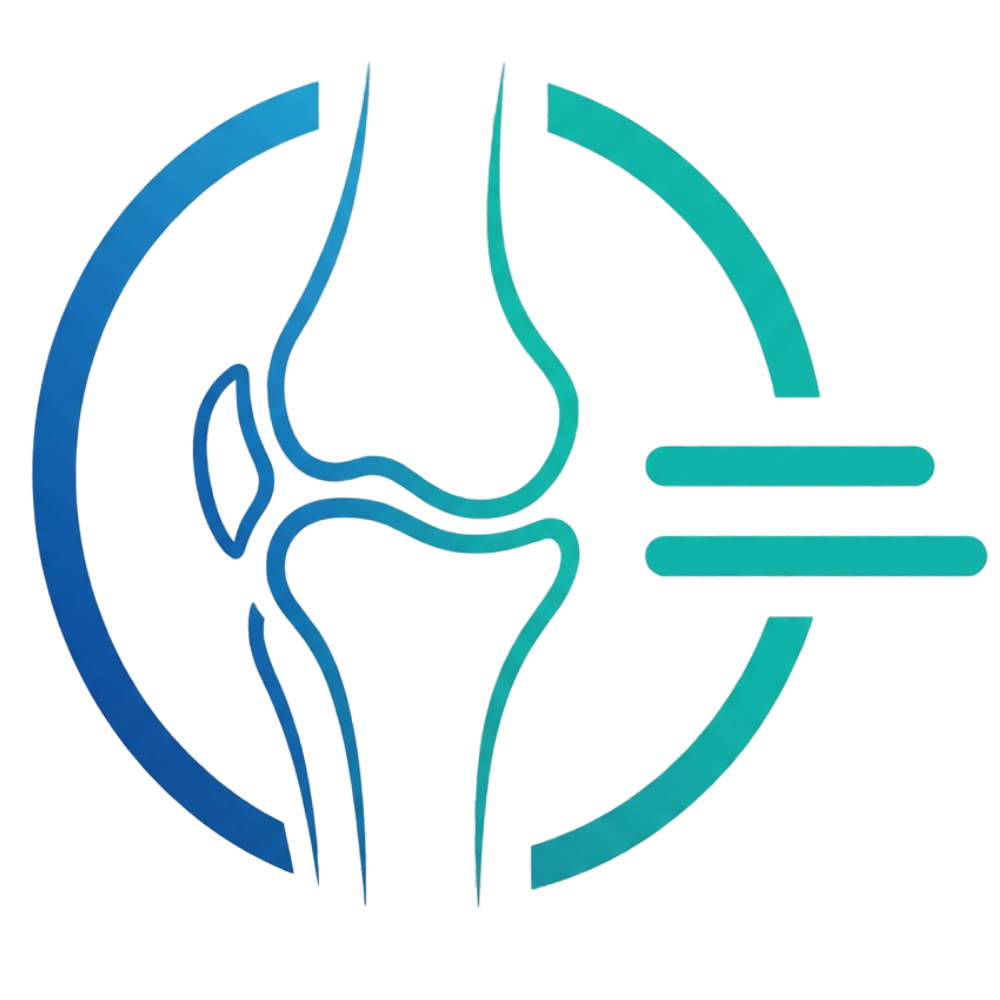
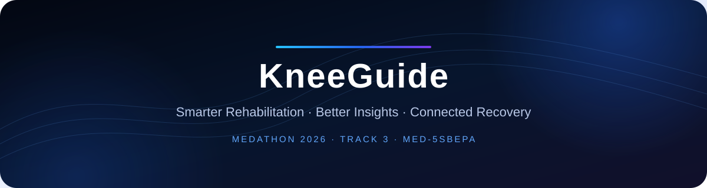
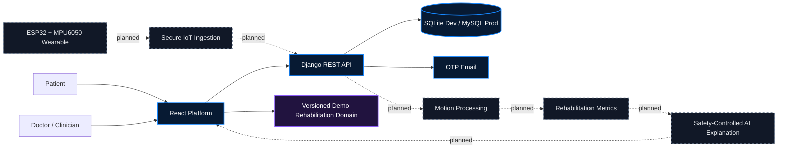
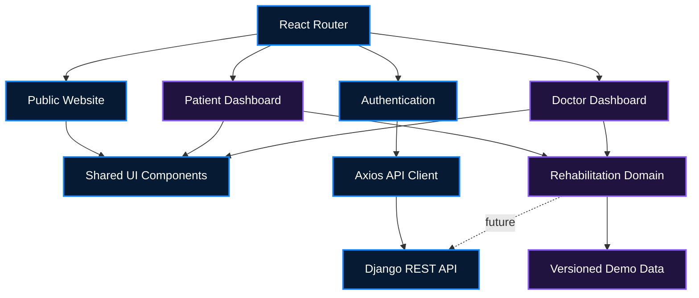
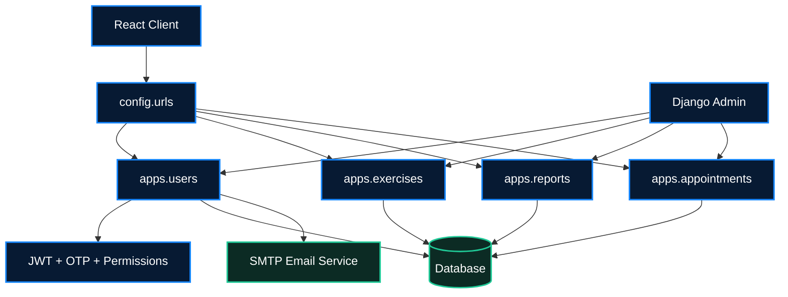
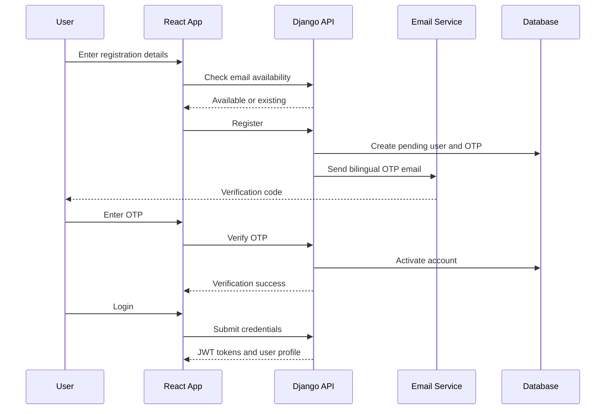
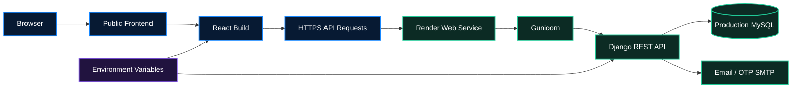
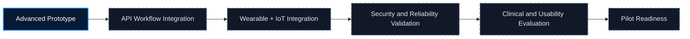

<div align="center">
  
  <h1>KneeGuide — Full-Stack Platform</h1>
  <p><strong>Smarter Rehabilitation. Better Insights. Connected Recovery.</strong></p>
  <p>AI-assisted smart knee rehabilitation for patients and healthcare professionals.</p>

  <p>
    <a href="https://knee.fyaa.io/"></a>
    <a href="#project-status"></a>
    <a href="#medathon-2026"></a>
  </p>
</div>



> **Medical-technology prototype:** KneeGuide supports rehabilitation monitoring and clinician decision-making. It does not diagnose, prescribe treatment, replace clinical assessment, or claim clinically validated outcomes.

## English overview

KneeGuide is a connected rehabilitation ecosystem designed to improve how knee-recovery information is recorded, communicated, and reviewed between patients and healthcare professionals. This unified repository contains the complete React platform and Django REST backend under one review-friendly link while preserving the original organization repositories.

Traditional rehabilitation is often evaluated through periodic appointments and patient-reported progress. KneeGuide explores how objective movement measurements, structured exercise records, appointment workflows, and clinician review can complement—not replace—professional assessment.

## نظرة عامة بالعربية

**KneeGuide** هو نموذج تقني لمنظومة تأهيل ذكية تهدف إلى تحسين متابعة تعافي الركبة والتواصل بين المريض والمختص الصحي. يحتوي هذا المستودع الموحّد على منصة React والـDjango REST Backend كاملين في رابط واحد، مع بقاء مستودعات المنظمة الأصلية مستقلة ومتاحة.

المشروع لا يقدم تشخيصًا طبيًا مستقلًا ولا يصف علاجًا ولا يستبدل قرار الطبيب. جميع وظائف الذكاء الاصطناعي وإنترنت الأشياء موضحة بصدق وفق حالتها الحالية: منفذة، تجريبية، أو مخططة.

## Full-stack repository

| Directory | Purpose | Complete documentation |
|---|---|---|
| [`frontend/`](./frontend/) | React public website, authentication, patient experience, clinician experience, bilingual UI, charts and demonstration workflows | [Full frontend README](./frontend/README.md) |
| [`backend/`](./backend/) | Django REST APIs, users, OTP verification, JWT authentication, exercises, reports, appointments, MySQL production persistence and Admin | [Full backend README](./backend/README.md) |
| [`docs/assets/`](./docs/assets/) | Shared branding assets for this repository overview | This README |

### Quick links

- [Live platform](https://knee.fyaa.io/)
- [Deployed backend](https://kneeguide-backend.onrender.com/)
- [KneeGuide organization](https://github.com/KneeGuide-Team)
- [Unified repository](https://github.com/FahadAlshwihani/KneeGuide-team)
- [Frontend technical documentation](https://github.com/KneeGuide-Team/kneeguide-frontend#readme)
- [Backend technical documentation](https://github.com/KneeGuide-Team/kneeguide-backend#readme)
- [Local frontend documentation](./frontend/README.md)
- [Local backend documentation](./backend/README.md)
- [Contribution guide](https://github.com/KneeGuide-Team/.github/blob/main/CONTRIBUTING.md)
- [Security policy](https://github.com/KneeGuide-Team/.github/blob/main/SECURITY.md)

### Repository structure

```text
KneeGuide-team/
├── frontend/
│   ├── public/
│   ├── src/
│   │   ├── api/
│   │   ├── components/
│   │   ├── domain/
│   │   ├── features/
│   │   ├── layouts/
│   │   └── routes/
│   ├── README.md
│   └── package.json
├── backend/
│   ├── apps/
│   │   ├── users/
│   │   ├── appointments/
│   │   ├── exercises/
│   │   └── reports/
│   ├── config/
│   │   └── settings/
│   ├── README.md
│   ├── manage.py
│   └── requirements.txt
├── docs/assets/
└── README.md
```

The nested frontend and backend READMEs are the complete documentation copied from their original repositories, including routes, components, API contracts, environment configuration, architecture diagrams, setup, deployment, limitations and roadmaps.

## The rehabilitation challenge

Between clinical appointments, professionals may have limited visibility into exercise adherence, range-of-motion trends, pain reports, and changes in recovery behavior. Patients may also struggle to understand their next exercise, appointment, progress, or clinician feedback.

KneeGuide proposes a shared rehabilitation record that can bring together:

1. Patient and clinician accounts.
2. Assigned rehabilitation exercises.
3. Session and adherence records.
4. Progress reports and clinician feedback.
5. Appointment coordination.
6. A planned ESP32/MPU6050 wearable prototype.
7. Planned secure motion-data ingestion and analysis.
8. A future safety-controlled AI explanation layer.

## Platform ecosystem



| Visual treatment | Meaning |
|---|---|
| Blue | Implemented platform or API foundation |
| Violet | Intentional demonstration data/workflow |
| Dashed slate | Planned integration, not operational in the inspected repositories |

## Frontend architecture



The frontend includes the public marketing experience, bilingual authentication, patient and clinician dashboard shells, shared UI components, a structured rehabilitation domain, data visualization, assistant demonstrations, appointments, exercises, reports and profile experiences.

For the complete route map, components, screenshots, mock-data boundaries and build configuration, open the **[frontend README](./frontend/README.md)**.

## Backend architecture



| Django application | Responsibility |
|---|---|
| `apps.users` | Custom users, patient/doctor roles, registration, email checks, OTP verification/resend, login, JWT and permissions |
| `apps.exercises` | Exercise assignment and rehabilitation exercise APIs |
| `apps.reports` | Exercise reports, progress data and reporting workflows |
| `apps.appointments` | Appointment creation, management and scheduling workflows |
| `config` | URL routing, WSGI/ASGI, shared settings and explicit development/production configuration |

For complete models, serializers, endpoints, permissions, migrations, security and deployment details, open the **[backend README](./backend/README.md)**.

## Authentication flow



## Rehabilitation workflow

```mermaid
flowchart LR
    ACCOUNT[Registration / Login] --> PROFILE[Patient Profile]
    PROFILE --> PLAN[Rehabilitation Plan]
    PLAN --> ASSIGNED[Assigned Exercises]
    ASSIGNED --> SESSION[Session Completion]
    SESSION --> TRACK[Progress Tracking]
    TRACK --> REPORT[Reports]
    REPORT --> REVIEW[Doctor Review]
    REVIEW -. clinician decision .-> ADJUST[Plan Adjustment]
    ADJUST --> ASSIGNED

    classDef implemented fill:#071a33,stroke:#1687ff,color:#fff,stroke-width:2px;
    classDef partial fill:#21133f,stroke:#8b5cf6,color:#fff,stroke-width:2px;
    class ACCOUNT,PROFILE implemented;
    class PLAN,ASSIGNED,SESSION,TRACK,REPORT,REVIEW,ADJUST partial;
```



## Product environments

### Patient experience

- Bilingual registration, OTP verification and login.
- Rehabilitation dashboard and daily guidance.
- Exercise-session experience and local completion history.
- Progress, pain and report visualizations.
- Appointment request demonstration flow.
- Profile, medical-information and device-interface areas.
- Deterministic bilingual assistant actions.

### Clinician experience

- Patient worklist and attention indicators.
- Patient rehabilitation workspace.
- Exercise, session, report and appointment views.
- Clinician notes and report review.
- Calendar and scheduling demonstrations.
- Deterministic assistant over the local demonstration domain.

## Project status

The status vocabulary is evidence-based: **Implemented**, **Partially Implemented**, **Demo / Mock Data**, **Planned**, and **Not Verified**.

| Component | Status | Current source | Remaining work |
|---|---|---|---|
| Public website | Implemented | React application | Continued accessibility and content QA |
| Registration, OTP and login | Implemented | Django REST API, JWT and SMTP | Delivery monitoring, throttling and broader integration tests |
| Patient dashboard | Demo / Mock Data | Versioned browser-local rehabilitation repository | Replace demo reads and mutations with authenticated APIs |
| Doctor dashboard | Demo / Mock Data | Shared browser-local rehabilitation repository | Connect patient and clinical workflows to backend services |
| Exercises | Partially Implemented | Rich frontend demo workflow and backend assignment API | Server-owned session/program model and synchronization |
| Appointments | Partially Implemented | Frontend request demo and backend doctor-led CRUD | Align workflow states and permissions |
| Reports | Partially Implemented | Frontend metrics plus backend report API | Persist validated sessions and motion metadata |
| AI Assistant | Demo / Mock Data | Deterministic browser rules | Authenticated orchestration, guardrails and optional LLM |
| Database | Implemented | SQLite development and MySQL production | Operational monitoring, backups and retention governance |
| Sensor prototype | Not Verified | ESP32/MPU6050 stated prototype; no firmware in these repositories | Firmware audit, calibration and bench evidence |
| IoT integration | Planned | No device-ingestion service currently exists | Secure protocol, identity, validation, storage and observability |
| LLM integration | Planned | No provider or inference code currently exists | Retrieval, clinical safety checks, validation and auditability |
| Clinical validation | Planned | No clinical-study artifacts in these repositories | Clinician review, safety/usability protocol and governed pilot |

## Demonstration-data policy

Mock data is intentional and disclosed. It enables reviewers to evaluate complete patient and clinician journeys without using real patient information while backend workflow and hardware integration continue.

- Authentication communicates with the deployed Django API.
- Dashboard exercises, sessions, reports, appointments, notes and patient histories currently use a versioned local demonstration repository.
- Device discovery and connection are simulated.
- Patient and doctor assistants are deterministic; they are not connected to an LLM.
- Demonstration records must never be presented as clinical evidence or real patient data.

## AI safety position

Any future LLM integration must sit behind authentication, role authorization, structured-data retrieval, clinical rules, response validation and clinician escalation. It must not independently:

- Diagnose a patient.
- Prescribe or change treatment.
- Override a clinician decision.
- Present uncertainty as medical certainty.

```mermaid
flowchart LR
    Q[Patient / Doctor Question] --> UI[React Assistant]
    UI -. planned .-> API[Django API]
    API -. planned .-> ACCESS[Authentication + Authorization]
    ACCESS -. planned .-> CONTEXT[Structured Rehabilitation Context]
    CONTEXT -. planned .-> RULES[Clinical Rules + Safety Checks]
    RULES -. planned .-> LLM[LLM Provider / Inference]
    LLM -. planned .-> VALIDATE[Response Validation]
    VALIDATE -. planned .-> EXPLAIN[AI-Assisted Explanation]
    EXPLAIN -. planned .-> UI

    classDef current fill:#21133f,stroke:#8b5cf6,color:#fff,stroke-width:2px;
    classDef planned fill:#111827,stroke:#64748b,color:#e5e7eb,stroke-width:2px,stroke-dasharray:5 5;
    class Q,UI current;
    class API,ACCESS,CONTEXT,RULES,LLM,VALIDATE,EXPLAIN planned;
```



## Wearable and IoT roadmap

The intended prototype uses an **ESP32** microcontroller and **MPU6050** motion sensing. The repositories do not currently contain firmware or a production ingestion service. Before integration, the team must define calibration, measurement units, timestamps, sampling quality, device-to-patient association, authenticated encryption, replay protection, payload validation, idempotency, reliability telemetry and separation of measured values from clinical interpretation.


## Technology stack

### Frontend

- React and React Router.
- JavaScript, HTML and CSS.
- Axios API client.
- i18next bilingual localization.
- Recharts for data visualization.
- Framer Motion and focused interactive components.
- Jest and React Testing Library.

### Backend

- Python and Django 5.2.
- Django REST Framework.
- Simple JWT authentication.
- django-cors-headers.
- SQLite for local development.
- MySQL for production.
- Gunicorn and WhiteNoise on Render.
- SMTP delivery with bilingual HTML and plain-text OTP templates.

Exact versions are defined in [`frontend/package.json`](./frontend/package.json) and [`backend/requirements.txt`](./backend/requirements.txt).

## API groups

| Group | Purpose |
|---|---|
| `/api/users/` | Registration, email checks, OTP verification/resend, login and user identity |
| `/api/exercises/` | Exercise assignment and rehabilitation exercise data |
| `/api/reports/` | Exercise reports and progress information |
| `/api/appointments/` | Appointment workflows |
| `/admin/` | Restricted Django administration |

Refer to the [backend README](./backend/README.md) and current URL/view implementations before integration; this summary does not replace the API contract.

## Security and privacy

Verified foundations include password hashing through Django authentication, JWT-based API authentication, role-aware user structures, bounded OTP verification, environment-based secrets, explicit production origins, server-side serializer/model validation and the absence of real patient information from committed demonstration data.

Remaining production work includes deeper authorization testing, rate limiting, operational alerting, backup/restore exercises, formal privacy governance, security review and clinical validation. The project does not claim regulatory compliance or medical-device certification.

## Deployment architecture



The live frontend is available at [knee.fyaa.io](https://knee.fyaa.io/). The backend is deployed on Render at [kneeguide-backend.onrender.com](https://kneeguide-backend.onrender.com/). Infrastructure not evidenced by the repositories is intentionally not inferred.

## Local development

### Frontend

```bash
cd frontend
npm install
npm start
```

Configure `REACT_APP_API_BASE_URL` through the documented frontend environment strategy.

### Backend

```bash
cd backend
python -m venv .venv

# Windows
.venv\Scripts\activate

# macOS / Linux
source .venv/bin/activate

pip install -r requirements.txt
python manage.py migrate
python manage.py runserver
```

Development defaults to `config.settings.development`. Production uses `config.settings.production` and its documented environment variables. Never commit local `.env` files or credentials.

## Testing

```bash
# Frontend
cd frontend
npm test
npm run build

# Backend
cd ../backend
python manage.py check
python manage.py makemigrations --check --dry-run
python manage.py test
```

## Roadmap



Near-term priorities are authenticated API integration across dashboards, server-owned rehabilitation sessions, firmware validation, secure IoT ingestion, authorization and end-to-end testing, operational monitoring and clinician-led safety/usability evaluation.

## Source synchronization

This combined repository is an independent review snapshot. The organization repositories remain the authoritative standalone development repositories.

| Application | Included source commit |
|---|---|
| Frontend | `a7a6a1a779e985b229dce6dacfd5799e4b757abb` |
| Backend | `794bd76296d0030c6e2a3a73ccfe4c490c4dfdb6` |

No source repository was deleted, renamed, moved or replaced when this unified repository was created.

## Reviewer guide

For a structured technical review:

1. Start with this organization overview.
2. Open the [frontend README](https://github.com/KneeGuide-Team/kneeguide-frontend#readme) for routes, product workflows, mock-data boundaries and local setup.
3. Open the [backend README](https://github.com/KneeGuide-Team/kneeguide-backend#readme) for APIs, models, permissions, security, deployment and database architecture.
4. Visit the [live platform](https://knee.fyaa.io/) for the current product experience.
5. Use repository issues or the security policy for responsible feedback. Do not submit real patient or sensitive medical information.

Public repositories are viewable by everyone. Only explicitly authorized organization members can modify project content.

## Engineering principles

- Evidence-based feature status; no hidden prototype limitations.
- Privacy by design and no real patient data in demonstrations.
- Clinician oversight for medical interpretation.
- Role-aware authorization and least privilege.
- Reproducible local setup and documented environments.
- No unsupported claims of effectiveness, accuracy, certification or regulatory approval.

## MEDATHON 2026

**Track:** Track 3 — Medical Tools & Devices Innovation

**Team code:** MED-5SBEPA

| Team member | Role |
|---|---|
| **Rakan Alshwihani** | Team Leader — Clinical & Medical Domain |
| **Eng. Fahad Alshwihani** | Lead Software Engineer — Full-Stack Systems, Backend Engineering, System Integration, Architecture & UX/UI Design |
| **Abdulaziz Alshwihani** | IoT & Hardware — Wearable Sensor Prototype and Device Integration |

### Software development credit

Developed and engineered by **Eng. Fahad Alshwihani**.

Portfolio: [fyaa.io](https://fyaa.io/)

Copyright © 2026 KneeGuide Team. All Rights Reserved. Existing repository license files, when present, remain authoritative. This organization profile does not introduce or alter licensing terms.
